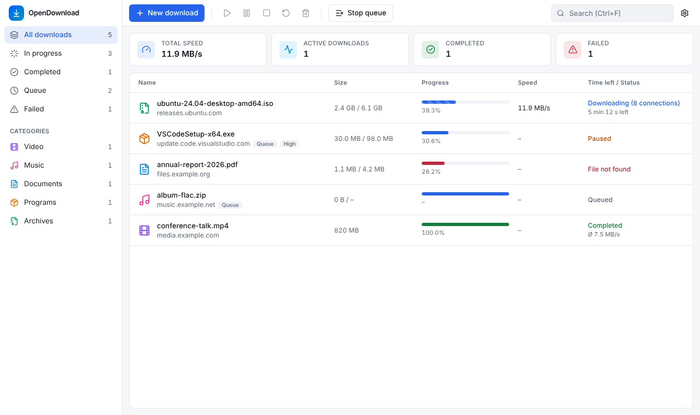
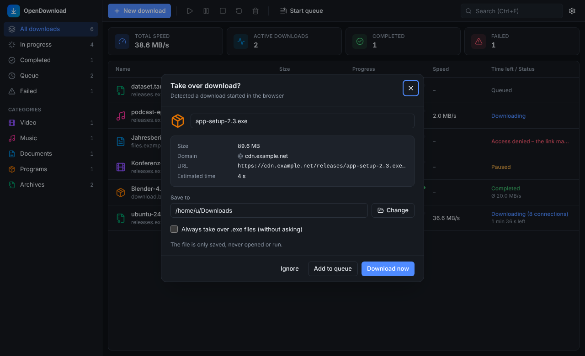
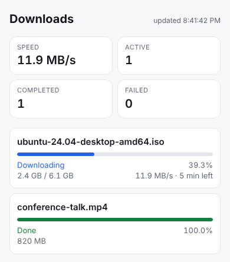

# OpenDownload Manager

A free, open-source download manager for **Windows 10/11** and **macOS** (Intel and Apple
Silicon). It downloads files over multiple connections, resumes interrupted downloads, takes
over downloads straight from your browser and can show progress on your phone. No ads, no
tracking, no account, no cloud.

Built with Tauri 2, Rust and React/TypeScript.



## Features

**Downloads**
* Up to 32 parallel connections per file when the server supports byte ranges – idle
  connections take over half of the largest remaining range, so all of them keep working
  until the end
* Pause and resume, even after an app restart or a dropped connection; detects when the file
  changed on the server (ETag/Last-Modified) and cleanly starts over
* Automatic retries with backoff, honours `Retry-After` (429/503), safe redirects
* Size check and optional SHA-256 verification; partial files (`.odmpart`) are only renamed
  once complete
* Speed modes: Maximum, Balanced, Custom limit (KB/s, MB/s)
* Queue with priorities, concurrency limit and schedule
* Prevents idle sleep while downloads are running (the screen may still lock)

**Browser integration**
* Extension for Chrome, Edge, Brave, Vivaldi and Firefox: detects downloads started in the
  browser and asks whether the app should take over – or takes over automatically
* File types, exclusions (domains, types, URL patterns), "Always take over this file type"
* Context menu "Download with OpenDownload Manager" for links, video and audio

**Phone view** (view only, off by default)
* Scan a QR code and follow progress on your phone in your home network
* Shows only file name, status, progress, speed and time left – no links, no controls

**User interface**
* Dashboard, categories, search, sorting, multi-select, context menus, keyboard shortcuts
* Drag and drop links, paste URLs from the clipboard, light and dark theme
* English and German (app, phone view and browser extension); follows the system language
  by default
* System tray / menu bar, minimise to background, notifications
* Programs (`.exe`, `.dmg`, …) are only opened after explicit confirmation

<p>
  
  
</p>

Full feature list and honest limitations: [docs/FEATURES.md](docs/FEATURES.md).

## Installation

There is no official release yet. Every push builds test packages automatically:

1. Open the latest green run under [Actions → CI](../../actions/workflows/ci.yml).
2. Download from "Artifacts" at the bottom:
   * **bundle-macos** – DMG (universal: Intel + Apple Silicon)
   * **bundle-windows** – installer (`*-setup.exe`) and MSI
   * **extension** – browser extension (`chrome/` and `firefox/`)
3. Install the app and start it once. It registers the browser integration by itself.

**macOS:** the test builds are not notarized. On first launch, right-click → "Open" (or System
Settings → Privacy & Security → "Open Anyway"), or run:

```bash
xattr -dr com.apple.quarantine "/Applications/OpenDownload Manager.app"
```

**Windows:** SmartScreen warns about unsigned programs – click "More info" → "Run anyway".

### Browser extension (Chrome, Edge, Brave, Vivaldi)

1. Unzip the **extension** artifact and keep the `chrome` folder in a permanent location.
2. Open `chrome://extensions` and switch on **Developer mode** (top right).
3. Click **"Load unpacked"** and select the `chrome` folder.
4. The extension popup should say "Connected to OpenDownload Manager". If not, click
   **Settings → Browser → Register** in the app and restart the browser.

Firefox and registration details: [docs/BROWSER_INTEGRATION.md](docs/BROWSER_INTEGRATION.md).

### Phone view

Turn it on under **Settings → Phone** in the app and scan the QR code with your phone's
camera (phone on the same Wi-Fi). On iPhone, use Safari's "Share → Add to Home Screen" to get
an app icon. Only enable it on trusted networks; for access on the go, use a VPN such as
Tailscale.

## A note on speed

The app shows **MB/s** (megabytes, binary), while internet plans are sold in **Mbit/s**:
100 Mbit/s is about **11.9 MB/s** in the app. Multiple connections only help when the server
throttles each connection – once your own line is fully used, it cannot go any faster.

## Development

Requirements: Rust (stable), Node.js 22 and the platform build tools
(see [docs/BUILD.md](docs/BUILD.md)).

```bash
npm ci
npm run app:dev                            # app with hot reload
cd extension && npm ci && npm run build    # extension → extension/dist/{chrome,firefox}
```

### Tests

```bash
cargo test --workspace                 # Rust: unit and integration tests against a local test server
npm run typecheck && npm test          # frontend
cd extension && npm test               # extension capture rules and translations
xvfb-run -a node e2e/browser-e2e.mjs   # Linux: Chromium → extension → host → app → file
```

### Building installers

```bash
npm run app:build    # Windows: NSIS + MSI, macOS: .app + DMG
```

Universal macOS builds, code signing and notarization: [docs/BUILD.md](docs/BUILD.md).
GitHub Actions builds test packages on every push and a draft release for `v*` tags.

### Project structure

```
crates/odm-core/          download engine, segments, queue, scheduler, SQLite, settings (Rust)
crates/odm-ipc/           protocol + local, authenticated IPC transport
crates/odm-native-host/   native messaging host for the browser extension
src-tauri/                Tauri 2 app: commands, IPC endpoint, tray, phone view, power management
src/                      React/TypeScript UI (Tailwind, Radix), translations in src/i18n/
extension/                WebExtension (MV3) for Chromium and Firefox
e2e/                      end-to-end test browser → host → app → file
scripts/                  build helpers (sidecar)
docs/                     architecture, browser integration, build, security, features
```

## Privacy

Everything runs locally. The app only connects to the servers of the files you download.
Cookies and passwords are never stored, and logs contain no URL parameters. Details:
[docs/SECURITY.md](docs/SECURITY.md).

## Documentation

The detailed documentation is currently in German:

* [Architecture & decisions](docs/ARCHITECTURE.md)
* [Browser integration & native messaging](docs/BROWSER_INTEGRATION.md)
* [Build, installation, signing](docs/BUILD.md)
* [Security & privacy](docs/SECURITY.md)
* [Features & limitations](docs/FEATURES.md)

## License

MIT – see [LICENSE](LICENSE).
