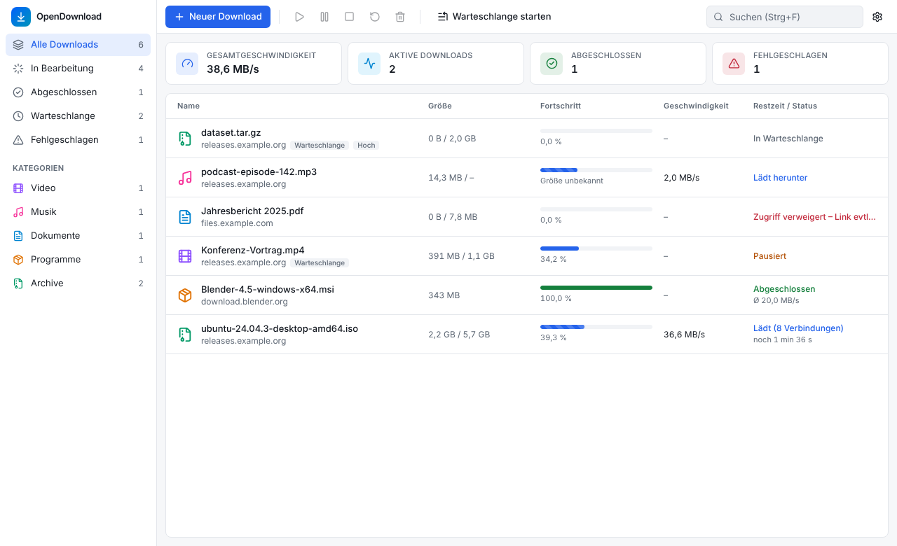

# OpenDownload Manager

Kostenloser, quelloffener Download-Manager für **Windows 10/11** und **macOS** (Intel und
Apple Silicon). Lädt Dateien über mehrere Verbindungen, setzt abgebrochene Downloads fort,
übernimmt Downloads direkt aus dem Browser und zeigt den Fortschritt auf Wunsch auch auf dem
Handy. Keine Werbung, kein Tracking, keine Registrierung, keine Cloud.

Gebaut mit Tauri 2, Rust und React/TypeScript.



## Funktionen

**Downloads**
* Bis zu 32 parallele Verbindungen pro Datei, wenn der Server Byte-Ranges unterstützt –
  freie Verbindungen übernehmen die Hälfte des größten Restbereichs, damit alle bis zum Ende arbeiten
* Pause und Fortsetzen, auch nach App-Neustart oder Verbindungsabbruch; erkennt, wenn sich die
  Datei auf dem Server geändert hat (ETag/Last-Modified) und lädt dann sauber neu
* Automatische Wiederholung mit Backoff, beachtet `Retry-After` (429/503), sichere Redirects
* Prüfung von Größe und optional SHA-256; Teildateien (`.odmpart`) werden erst am Ende umbenannt
* Geschwindigkeitsmodi: Maximal, Ausgewogen, Benutzerdefiniert (KB/s, MB/s)
* Warteschlange mit Prioritäten, Parallelitätslimit und Zeitplan
* Verhindert den automatischen Ruhezustand, solange Downloads laufen (Bildschirm darf sich sperren)

**Browser-Integration**
* Erweiterung für Chrome, Edge, Brave, Vivaldi und Firefox: erkennt im Browser gestartete
  Downloads und fragt, ob die App übernehmen soll – oder übernimmt automatisch
* Dateitypen, Ausnahmen (Domains, Typen, URL-Teile), „Immer für diesen Dateityp übernehmen“
* Kontextmenü „Mit OpenDownload Manager herunterladen“ für Links, Video und Audio

**Handy-Ansicht** (nur ansehen, standardmäßig aus)
* QR-Code scannen und den Fortschritt im Heimnetz auf dem Smartphone verfolgen
* Zeigt nur Dateiname, Status, Fortschritt, Geschwindigkeit und Restzeit – keine Links, keine Steuerung

**Oberfläche**
* Dashboard, Kategorien, Suche, Sortierung, Mehrfachauswahl, Kontextmenüs, Tastaturkürzel
* Drag-and-drop von Links, URL aus der Zwischenablage, helles/dunkles Design
* Deutsch und Englisch (App, Handy-Ansicht und Browser-Erweiterung); Standard ist die Systemsprache
* Tray bzw. Menüleiste, Minimieren in den Hintergrund, Benachrichtigungen
* Programme (`.exe`, `.dmg`, …) werden nur nach ausdrücklicher Bestätigung geöffnet

<p>
  
  
</p>

Vollständige Liste und ehrliche Einschränkungen: [docs/FEATURES.md](docs/FEATURES.md).

## Installation

Es gibt noch kein offizielles Release. Testbuilds erzeugt jeder Push automatisch:

1. Unter [Actions → CI](../../actions/workflows/ci.yml) den neuesten grünen Lauf öffnen.
2. Unten bei „Artifacts“ herunterladen:
   * **bundle-macos** – DMG (Universal: Intel + Apple Silicon)
   * **bundle-windows** – Installer (`*-setup.exe`) und MSI
   * **extension** – Browser-Erweiterung (`chrome/` und `firefox/`)
3. App installieren und einmal starten. Sie registriert die Browser-Integration selbst.

**macOS:** Die Testbuilds sind nicht notarisiert. Beim ersten Start Rechtsklick → „Öffnen“
(oder Systemeinstellungen → Datenschutz & Sicherheit → „Dennoch öffnen“), alternativ:

```bash
xattr -dr com.apple.quarantine "/Applications/OpenDownload Manager.app"
```

**Windows:** SmartScreen warnt bei unsignierten Programmen – „Weitere Informationen“ →
„Trotzdem ausführen“.

### Browser-Erweiterung (Chrome, Edge, Brave, Vivaldi)

1. Das Artefakt **extension** entpacken und den Ordner `chrome` an einem festen Ort ablegen.
2. `chrome://extensions` öffnen, oben rechts den **Entwicklermodus** einschalten.
3. **„Entpackte Erweiterung laden“** → den Ordner `chrome` wählen.
4. Im Popup der Erweiterung sollte „Verbunden mit OpenDownload Manager“ stehen. Falls nicht:
   in der App **Einstellungen → Browser → Registrieren** und den Browser neu starten.

Firefox und Details zur Registrierung: [docs/BROWSER_INTEGRATION.md](docs/BROWSER_INTEGRATION.md).

### Handy-Ansicht

In der App **Einstellungen → Handy** einschalten, den QR-Code mit der Handy-Kamera scannen
(Handy im selben WLAN). Auf dem iPhone in Safari „Teilen → Zum Home-Bildschirm“ für ein
App-Symbol. Nur in vertrauenswürdigen Netzen aktivieren; für unterwegs eignet sich ein VPN
wie Tailscale.

## Hinweis zur Geschwindigkeit

Die App zeigt **MB/s** (Megabyte, binär), Internettarife werden in **Mbit/s** angegeben:
100 Mbit/s entsprechen etwa **11,9 MB/s** in der Anzeige. Mehrere Verbindungen helfen nur,
wenn der Server pro Verbindung drosselt – ist die eigene Leitung voll ausgelastet, geht es
nicht schneller.

## Entwicklung

Voraussetzungen: Rust (stable), Node.js 22 und die plattformspezifischen Build-Tools
(siehe [docs/BUILD.md](docs/BUILD.md)).

```bash
npm ci
npm run app:dev                            # App mit Hot-Reload
cd extension && npm ci && npm run build    # Erweiterung → extension/dist/{chrome,firefox}
```

### Tests

```bash
cargo test --workspace                 # Rust: Unit- und Integrationstests mit lokalem Testserver
npm run typecheck && npm test          # Frontend
cd extension && npm test               # Erfassungsregeln der Erweiterung
xvfb-run -a node e2e/browser-e2e.mjs   # Linux: Chromium → Erweiterung → Host → App → Datei
```

### Installer bauen

```bash
npm run app:build    # Windows: NSIS + MSI, macOS: .app + DMG
```

Universal-Build für macOS, Signierung und Notarisierung: [docs/BUILD.md](docs/BUILD.md).
GitHub Actions bauen bei jedem Push Testpakete und bei Tags `v*` ein Draft-Release.

### Projektstruktur

```
crates/odm-core/          Download-Engine, Segmente, Queue, Scheduler, SQLite, Einstellungen (Rust)
crates/odm-ipc/           Protokoll + lokaler, authentifizierter IPC-Transport
crates/odm-native-host/   Native-Messaging-Host für die Browser-Erweiterung
src-tauri/                Tauri-2-App: Commands, IPC-Endpunkt, Tray, Handy-Ansicht, Energieverwaltung
src/                      React/TypeScript-Oberfläche (Tailwind, Radix)
extension/                WebExtension (MV3) für Chromium und Firefox
e2e/                      Ende-zu-Ende-Test Browser → Host → App → Datei
scripts/                  Build-Helfer (Sidecar)
docs/                     Architektur, Browser-Integration, Build, Sicherheit, Funktionen
```

## Datenschutz

Alles läuft lokal. Die App verbindet sich nur mit den Servern der Dateien, die du herunterlädst.
Cookies und Passwörter werden nie gespeichert, Logs enthalten keine URL-Parameter. Details:
[docs/SECURITY.md](docs/SECURITY.md).

## Dokumentation

* [Architektur & Entscheidungen](docs/ARCHITECTURE.md)
* [Browser-Integration & Native Messaging](docs/BROWSER_INTEGRATION.md)
* [Build, Installation, Signierung](docs/BUILD.md)
* [Sicherheit & Datenschutz](docs/SECURITY.md)
* [Funktionen & Einschränkungen](docs/FEATURES.md)

## Lizenz

MIT – siehe [LICENSE](LICENSE).
